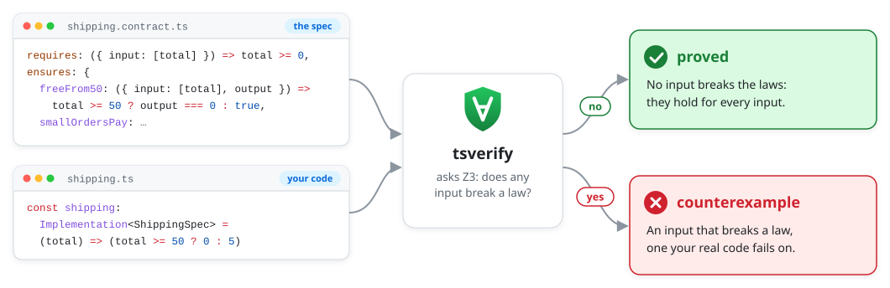

<div align="center">
  
  <h1>tsverify</h1>
  <h3><em>Prove that your TypeScript code keeps its spec for every input, or get the input that breaks it.</em></h3>
</div>

<p align="center">
  <a href="https://github.com/emyann/tsverify/actions/workflows/ci.yml"></a>
  <a href="LICENSE"></a>
  
  
  <a href="#status"></a>
</p>

You write a spec in plain TypeScript: a function's type, and the laws it must keep. tsverify reads the spec and your code
as they are, and asks the [Z3](https://github.com/Z3Prover/z3) solver, for each law, whether any input breaks it. The
answer is a proof, or that input.

<p align="center">
  <picture>
    <source media="(prefers-color-scheme: dark)" srcset="media/flow-dark.svg">
    
  </picture>
</p>

<!-- file: src/shipping.contract.ts -->
```ts
// src/shipping.contract.ts: what `shipping` must do, written before the code.
import { spec } from "tsverify"

const shippingSpec = spec<(total: number) => number>({
  // What every caller promises: a cart's total is never negative.
  requires: (total) => total >= 0,
  ensures: {
    // An order of 50 or more ships free.
    freeFrom50: (total, cost) => total < 50 || cost === 0,
    // A smaller one pays 5.
    smallOrdersPay: (total, cost) => total >= 50 || cost === 5,
  },
})
// Its type, which the code takes.
export type ShippingSpec = typeof shippingSpec
```

<!-- file: src/shipping.ts -->
```ts
// src/shipping.ts: the code takes its type from the spec, and imports nothing that runs.
import type { Implementation } from "tsverify"
import type { ShippingSpec } from "./shipping.contract.ts"

export const shipping: Implementation<ShippingSpec> = (total) => (total >= 50 ? 0 : 5)
```

<!-- run -->
```text
$ npx tsverify
src/shipping.ts
  shipping
    proved          freeFrom50  (98 ms)
    proved          smallOrdersPay  (13 ms)

1 contract in 1 file: laws 2 proved
```

Proved means for *every* total, not for a sample: 49.99, 50, 10 billion, and every other number the promise allows.
Without the promise, it would have answered `e.g. (NaN)`, a total that is not a number.

Now make the mistake everyone makes once, `>` where `>=` was meant:

<!-- file: src/shipping.ts -->
```ts
import type { Implementation } from "tsverify"
import type { ShippingSpec } from "./shipping.contract.ts"

export const shipping: Implementation<ShippingSpec> = (total) => (total > 50 ? 0 : 5)
```

<!-- run, exits 1 -->
```text
$ npx tsverify
src/shipping.ts
  shipping
    counterexample  freeFrom50  (93 ms)
                    e.g. (50)
    proved          smallOrdersPay  (14 ms)

1 contract in 1 file: laws 1 counterexample, 1 proved
```

`shipping(50)` returns `5`: an order of exactly 50 pays for shipping. A counterexample is never a false alarm: it is
found on an exact model of JavaScript, so your real code breaks on it. The command exits 1, so a CI step, or a coding
agent, knows the work is not done.

## Why tsverify

- **Every input, not a sample.** A unit test checks the inputs you wrote down, and a property test checks a few
  thousand random ones. A proved law holds for all of them: arrays of any length, every string, every number with `NaN`
  and `-0` among them, every bigint.
- **Plain TypeScript.** A law is a predicate, a spec is a value, and the code implements it as a type. No new language,
  no annotations, no comments to parse. `tsc` keeps the code and its spec in step, and nothing of tsverify runs in your
  app.
- **Laws about what code did.** For async code and Effect programs, a law reads the calls the code made, in order, with
  their arguments and results: "a refused withdrawal writes nothing".
- **Answers you can act on.** A counterexample comes with the input, and with what each call returned on that run. A law
  that says nothing of the function is flagged `vacuous`. The full report shows which outcomes the function can reach,
  each with an input that reaches it.
- **Loops too.** It guesses the invariants a loop needs, and you write one when its guess is not enough.
- **It says what it cannot do.** Code it cannot read is refused, at its line, with what to write instead. It never treats
  a part it cannot read as correct, and every report lists what it took on trust.

## Laws about what code did

Here the store is an interface, and each of its methods is an operation: tsverify records every call the code makes to
it.

<!-- file: src/rename.contract.ts -->
```ts
import { type Rejects, spec } from "tsverify"

/** Where names are kept. Each method is an operation: tsverify records every call. */
export interface Names {
  readonly get: (id: string) => Rejects<string | undefined, Error>
  readonly set: (id: string, name: string) => Rejects<void, Error>
}

const renameSpec = spec<(names: Names, id: string, name: string) => Rejects<boolean, Error>>({
  ensures: {
    // An empty name never reaches the store: not a single call.
    emptyNameTouchesNothing: (_names, _id, name, _out, calls) => name !== "" || calls.length === 0,
  },
})
export type RenameSpec = typeof renameSpec
```

<!-- file: src/rename.ts -->
```ts
import type { Implementation } from "tsverify"
import type { RenameSpec } from "./rename.contract.ts"

export const rename: Implementation<RenameSpec> = async (names, id, name) => {
  const current = await names.get(id)
  if (current === undefined || name === "") return false
  await names.set(id, name)
  return true
}
```

<!-- run, exits 1 -->
```text
$ npx tsverify src/rename.ts
src/rename.ts
  rename
    counterexample  emptyNameTouchesNothing  (94 ms)
                    e.g. ({}, "", "")
                    where names.get gave ""

1 contract in 1 file: laws 1 counterexample
```

With an empty name, the code still read the store before it said no. Check the name first, and the law is proved:

<details>
<summary>The fix</summary>

<!-- file: src/rename.ts -->
```ts
import type { Implementation } from "tsverify"
import type { RenameSpec } from "./rename.contract.ts"

export const rename: Implementation<RenameSpec> = async (names, id, name) => {
  if (name === "") return false
  const current = await names.get(id)
  if (current === undefined) return false
  await names.set(id, name)
  return true
}
```

<!-- run -->
```text
$ npx tsverify src/rename.ts
src/rename.ts
  rename
    proved          emptyNameTouchesNothing  (142 ms)

1 contract in 1 file: laws 1 proved
```

</details>

Effect programs work the same way, their services being the operations ([Effect programs](docs/effect.md)).
[`examples/hono`](examples/hono) is a users API in Hono built twice, with async handlers and with Effect ones, both proved
against the same laws.

## How it compares to property testing

On the same laws, a well-tuned property tester often finds the same bugs. In
[a benchmark](docs/measurements.md#a-state-machine-an-orders-status) of 17 bugs planted in a 10-status state machine, the
solver and property testing (seeded random inputs, biased toward the edge cases) each caught the same 10. The difference
is in the other 7. The solver explained every one: 2 were harmless, proved to behave like the original for every input,
and 5 slipped through a gap in the laws, each shown with an input. Random testing said nothing of them.

So the gain is less about catching more bugs, and more about proofs instead of samples, and answers about the spec
itself: where it is weak, what the code can reach, and which laws say nothing.

## Install

tsverify is not on npm yet. Build a tarball from this repository and install it in your project:

```sh
npm pack                                          # here: builds the package, writes tsverify-0.0.0.tgz
npm install --save-dev <path>/tsverify-0.0.0.tgz  # in your project; add `effect` for Effect programs
npx tsverify                                      # every contract under the current folder
```

It needs Node 24.16 or later, and brings its own `typescript` and `z3-solver`. It reads every file that imports
`tsverify`, whatever its name; these pages name a spec's file `*.contract.ts`, which no test runner mistakes for a test.

Your `tsconfig.json` needs `strict` (or at least `strictNullChecks`), and a module resolution that reads a package's
`exports`: `nodenext`, `node16` or `bundler`. The one these examples use:

<!-- file: tsconfig.json -->
```json
{
  "compilerOptions": {
    "target": "es2023",
    "module": "nodenext",
    "moduleResolution": "nodenext",
    "strict": true,
    "noEmit": true,
    "allowImportingTsExtensions": true,
    "skipLibCheck": true,
    "types": []
  }
}
```

## What it answers

| Verdict | What it means |
| --- | --- |
| `proved` | No input the spec allows breaks the law. |
| `counterexample` | One does, and `e.g.` gives it, with what each call returned on that run. |
| `vacuous` | Proved, but no result of the function could break it: the law says nothing of the function. |
| `bounded` | Not proved, and no input with arrays of up to 4 elements breaks it. The reason says what stands in the way. |
| `unsupported` | The law uses something tsverify does not read. The reason says what to write instead. |
| `unknown` | The solver gave no answer. |
| `inconsistent` | tsverify contradicted itself: a bug of tsverify, never a verdict on your code. |

The command exits 0 only when every law is `proved`. [Reading a report](docs/verdicts.md) has each verdict, what to do
about it, and `--json` for tools.

## Learn more

- [Writing a spec](docs/specs.md): pure functions, async code and its calls, code that already exists.
- [Reading a report](docs/verdicts.md): each verdict and what to do next; the command and its exit codes.
- [Effect programs](docs/effect.md): services as operations, typed errors, the forms it reads.
- [Loops and proof code](docs/proofs.md): the invariants it guesses, and `invariant`, `assert` and lemmas.
- [What it reads, refuses and trusts](docs/reads.md): the TypeScript it reads, each refusal and its fix, `assume`.
- [What the examples show](docs/measurements.md): every measurement, beside property testing.
- [How it works](docs/how-it-works.md): the two sides of each check, and how code becomes Z3.

| Import | For |
| --- | --- |
| `tsverify` | `spec` and `Implementation`; `contract` for code that already exists; `assume`; `invariant`, `assert`, `lemma`; the types a law reads, `Outcome` and `Rejects` |
| `tsverify/effect` | `spec` and `computation` for an Effect program |
| `tsverify/packs/lodash` | what tsverify may assume of the lodash functions it covers |
| `tsverify/api` | the verifier as a library: `loadProject`, `verify`, `openZ3` |
| `tsverify/mutants` | bugs planted against your laws: the solver beside property testing |

## Status

A prototype: version 0.0.0, not on npm, and its API may change. Every example in these pages is run by its tests, the
output shown included. What matters most before you rely on it:

- **Arguments are taken to have their types**, and code to throw only where it says so. At the edge of a program, check
  values first (with a schema, say).
- **What you declare with `assume` is trusted**, not proved, and every report lists it.
- **A loop is taken to end.**
- **The examples are the author's own**, so they show what tsverify reads and catches, not yet how it fares on code
  someone else wrote.

[All the caveats](docs/reads.md#caveats) · [What comes next](docs/roadmap.md) · [Contributing](CONTRIBUTING.md)

## License

MIT
