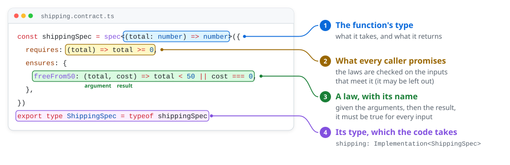

# Writing a spec

A spec is what a function must do, written before the function: its type, what a caller promises, and its laws. The
code takes the spec as its type, so a spec is also where the code's signature comes from.

## The spec, then the code

`spec<F>({ requires?, ensures })`, from `@emyann/tsverify`, takes the function's type as `F`.

<p align="center">
  <picture>
    <source media="(prefers-color-scheme: dark)" srcset="../media/anatomy-dark.svg">
    
  </picture>
</p>

| Part | What it is |
| --- | --- |
| `F`, in `spec<F>` | The function's type: what it takes, and what it returns. The code gets it as its type. |
| `requires` | What every caller promises, `({ input: [args...] }) => boolean`. The laws are checked only on the inputs that meet it. It may be left out. |
| `ensures` | The laws, each named for what it says: the report gives each its own line. A law reads one run of the function, as one object typed from `F`, so it needs no annotation: a pure function's is `({ input: [args...], output }) => boolean`, its arguments a tuple, a name for each the law reads and a hole for the rest (`[, amount]`), and its result. A law of async code reads `calls` beside them, and its `output` is the outcome (*Async code*, below). A law may also say what it means in words, `{ description: "…", condition: ({ input, output }) => boolean }`: the report prints the sentence on its line. |
| `export type StatusSpec = typeof statusSpec` | The spec's type, and all the code imports: it is typed `Implementation<StatusSpec>`, which is `F`. `Implementation<typeof statusSpec>` is the same without the line, the spec exported. |

**"If A, then B" is `A ? B : true`.** A law has nothing to say of an input where A is false, so it is true there.
`!A || B` says the same, the property-testing way, its premise turned around: `total < 50 || output === 0` is
`total >= 50 ? output === 0 : true`. The type checker narrows in either: once `c.op === "put"`, `c.args[0]` is the `put`'s.

A parcel's status, from a record with two dates that may be missing:

<!-- file: src/parcel.contract.ts -->
```ts
import { spec } from "@emyann/tsverify"
import type { Parcel, Status } from "./parcel.ts"

const statusSpec = spec<(parcel: Parcel) => Status>({
  requires: ({ input: [parcel] }) => (parcel.deliveredAt !== null ? parcel.shippedAt !== null && parcel.deliveredAt >= parcel.shippedAt : true),
  ensures: {
    deliveredWins: ({ input: [parcel], output }) => (parcel.deliveredAt !== null ? output === "delivered" : true),
    lostOnlyIfNotDelivered: ({ input: [parcel], output }) => (output === "lost" ? parcel.lost && parcel.deliveredAt === null : true),
    waitingUntilShipped: ({ input: [parcel], output }) => (output === "waiting") === (parcel.shippedAt === null && !parcel.lost),
  },
})
export type StatusSpec = typeof statusSpec
```

The code declares itself an implementation of the spec, `Implementation<StatusSpec>`, and `tsc` gives it the spec's
type. Both files import only the other's types, so nothing of the spec is in what runs:

<!-- file: src/parcel.ts -->
```ts
import type { Implementation } from "@emyann/tsverify"
import type { StatusSpec } from "./parcel.contract.ts"

export interface Parcel {
  readonly shippedAt: bigint | null
  readonly deliveredAt: bigint | null
  readonly lost: boolean
}
export type Status = "waiting" | "in-transit" | "delivered" | "lost"

export const statusOf: Implementation<StatusSpec> = (parcel) => {
  if (parcel.deliveredAt !== null) return "delivered"
  if (parcel.lost) return "lost"
  return parcel.shippedAt === null ? "waiting" : "in-transit"
}
```

<!-- run -->
```text
$ npx tsverify src/parcel.ts
src/parcel.ts
  ✓ statusOf  3 laws  (224 ms)
    ✓ deliveredWins  (121 ms)
    ✓ lostOnlyIfNotDelivered  (15 ms)
    ✓ waitingUntilShipped  (21 ms)

✓ 3 laws proved
  1 contract in 1 file · 0.9 s
```

Given files, the command verifies every contract they export: each `const` typed `Implementation<S>`, and each
`contract`, `computation` or lemma. Given a folder, or nothing (the current folder), it reads every file under it that
imports `@emyann/tsverify`, whatever its name, outside `node_modules` and dot folders. The names are the project's: these pages
write a spec in `*.contract.ts`, which no test runner claims, where Jest and Vitest run every `*.spec.ts` as a test.

**A law says what holds, not how.** `waitingUntilShipped` does not restate the code's `if`s; it says when the parcel waits,
in the record's words. A law that copies the code proves only that the code is the code.

**A spec is what its callers know.** Code that calls `statusOf` takes what `StatusSpec` proves of it, where its
`requires` holds, and nothing of its body, with no declaration to write: a law the callers need of it belongs in its
spec ([A function that implements a spec](reads.md#a-function-that-implements-a-spec)).

## Async code: laws over what it did

A function that returns a promise is a *computation*: it calls operations on what it is given, and ends in a success or a
failure. Its laws take, after its arguments, how it ended and the calls it made:

- **the outcome**, `{ _tag: "Success", value }` or `{ _tag: "Failure", error }`. A `throw` is a failure, and so is an
  operation's failure the code does not catch.
- **the calls**, in the order made: `{ target, op, args, outcome }` for each call of a method of an argument that returns
  a promise. They are typed from the arguments' types, so checking `op` narrows `args` and `outcome`.

`Rejects<A, E>`, from `@emyann/tsverify`, is a `Promise<A>` that also says what it rejects with, `E`. A plain `Promise<A>` may
reject with anything: its failure is `unknown`, carried and never read, so a law can say that it failed, not with what.

A store of users, each of its methods an operation:

<!-- file: src/users.ts -->
```ts
import type { Rejects } from "@emyann/tsverify"

export interface User {
  readonly id: string
  readonly name: string
}

export class NotFound extends Error {
  readonly _tag = "NotFound" as const
}

export class StoreDown extends Error {
  readonly _tag = "StoreDown" as const
}

/** Where users are kept: each method an operation the verifier records. */
export interface Users {
  readonly get: (id: string) => Rejects<User | undefined, StoreDown>
  readonly put: (user: User) => Rejects<void, StoreDown>
}
```

Renaming a user reads it, fails if it is missing, and writes it back renamed. A first spec:

<!-- file: src/rename.contract.ts -->
```ts
import { type Rejects, spec } from "@emyann/tsverify"
import type { NotFound, StoreDown, Users } from "./users.ts"

const renameSpec = spec<(users: Users, id: string, name: string) => Rejects<void, NotFound | StoreDown>>({
  ensures: {
    readsTheUserFirst: ({ input: [, id], calls }) => {
      const first = calls.at(0)
      return first !== undefined && first.op === "get" && first.args[0] === id
    },
    writesNothingWhenMissing: ({ output, calls }) => {
      const first = calls.at(0)
      if (first === undefined || first.op !== "get" || first.outcome._tag !== "Success" || first.outcome.value !== undefined) return true
      return output._tag === "Failure" && output.error._tag === "NotFound" && !calls.some((c) => c.op === "put")
    },
    writesTheNewName: ({ input: [, id, name], output, calls }) => {
      if (output._tag !== "Success") return true
      const write = calls.at(1)
      return calls.length === 2 && write !== undefined && write.op === "put" && write.args[0].id === id && write.args[0].name === name
    },
  },
})
export type RenameSpec = typeof renameSpec
```

<!-- file: src/rename.ts -->
```ts
import type { Implementation } from "@emyann/tsverify"
import type { RenameSpec } from "./rename.contract.ts"
import { NotFound } from "./users.ts"

export const rename: Implementation<RenameSpec> = async (users, id, name) => {
  const user = await users.get(id)
  if (user === undefined) throw new NotFound(id)
  await users.put({ ...user, name })
}
```

<!-- run, exits 1 -->
```text
$ npx tsverify src/rename.ts
src/rename.ts
  ✗ rename  1 counterexample, 2 proved  (259 ms)
    ✓ readsTheUserFirst  (88 ms)
    ✓ writesNothingWhenMissing  (66 ms)
    ✗ writesTheNewName  (30 ms)
      e.g. ({}, "", "")
      where users.get gave { id: "A", name: "" }, users.put succeeded

✗ 1 counterexample
✓ 2 laws proved
  1 contract in 1 file · 1.0 s
```

The code is what was meant; the law is not. Asked for `""`, the store gave back a user whose id is `"A"`, and the code
wrote that user renamed. Nothing says a store returns the user asked for, and the law took it for granted. Here the law
should say what the code means, that it writes the user it read:

<!-- file: src/rename.contract.ts -->
```ts
import { type Rejects, spec } from "@emyann/tsverify"
import type { NotFound, StoreDown, Users } from "./users.ts"

const renameSpec = spec<(users: Users, id: string, name: string) => Rejects<void, NotFound | StoreDown>>({
  ensures: {
    readsTheUserFirst: ({ input: [, id], calls }) => {
      const first = calls.at(0)
      return first !== undefined && first.op === "get" && first.args[0] === id
    },
    writesNothingWhenMissing: ({ output, calls }) => {
      const first = calls.at(0)
      if (first === undefined || first.op !== "get" || first.outcome._tag !== "Success" || first.outcome.value !== undefined) return true
      return output._tag === "Failure" && output.error._tag === "NotFound" && !calls.some((c) => c.op === "put")
    },
    writesTheUserItReadRenamed: ({ input: [, , name], output, calls }) => {
      if (output._tag !== "Success") return true
      const read = calls.at(0)
      const write = calls.at(1)
      if (read === undefined || read.op !== "get" || read.outcome._tag !== "Success" || read.outcome.value === undefined) return false
      return calls.length === 2 && write !== undefined && write.op === "put" && write.args[0].id === read.outcome.value.id && write.args[0].name === name
    },
  },
})
export type RenameSpec = typeof renameSpec
```

<!-- run -->
```text
$ npx tsverify src/rename.ts
src/rename.ts
  ✓ rename  3 laws  (240 ms)
    ✓ readsTheUserFirst  (89 ms)
    ✓ writesNothingWhenMissing  (68 ms)
    ✓ writesTheUserItReadRenamed  (7 ms)

✓ 3 laws proved
  1 contract in 1 file · 0.9 s
```

The other choice was to change the code, `{ ...user, id, name }`, and keep the first law. Either way a person decides
which behaviour is meant; the verifier's part is to show that the two differ, and on what.

**A check of `op` narrows a call wherever it stands.** "The last call", `calls.at(-1)`, is a `get` on a run that fails
and a `put` on one that succeeds; once a law has checked `last.op === "put"`, `last.args[0]` is the user written. Over
every call it is the same: `calls.every((c) => (c.op === "put" ? c.args[0].name === name : true))` reads each `put`'s argument,
and no run reads a `get`'s there.

The Effect adapter reads an Effect program the same way, its operations the methods of the services it requires:
[Effect programs](effect.md).

## Code that already exists

A `function` declaration takes no type annotation, and some code is not yours to change. For those, the spec names the
function instead: `contract(fn, { requires?, ensures })`. The type checker resolves `fn` to its declaration, and each law
is typed from the function's own signature.

<!-- file: src/overdue.ts -->
```ts
/** Whether something due at `due` is overdue at `now`; nothing is overdue that has no due date. */
export function isOverdue(due: bigint | null, now: bigint): boolean {
  return due !== null && due < now
}
```

<!-- file: src/overdue.contract.ts -->
```ts
import { contract } from "@emyann/tsverify"
import { isOverdue } from "./overdue.ts"

export const overdue = contract(isOverdue, {
  ensures: {
    neverWithoutADate: ({ input: [due], output }) => (due === null ? !output : true),
    lateOnlyAfter: ({ input: [due, now], output }) => (output ? due !== null && now > due : true),
  },
})
```

<!-- run -->
```text
$ npx tsverify src/overdue.contract.ts
src/overdue.contract.ts
  ✓ overdue  2 laws  (146 ms)
    ✓ neverWithoutADate  (98 ms)
    ✓ lateOnlyAfter  (20 ms)

✓ 2 laws proved
  1 contract in 1 file · 0.9 s
```

The code imports nothing of `@emyann/tsverify`, and the spec imports the code. For an async function that exists,
`computation<Ops, E>()(fn, { ensures })` does the same, its calls those of `Ops`, an object of the interfaces it is given;
for an Effect program, `computation<Ops>()` from `@emyann/tsverify/effect`.

## What a law may do

A law and a `requires` are *spec code*: pure and deterministic. The verifier reads them as it reads the code, and refuses
spec code that runs a computation, calls an operation, reads the clock, or calls a function declared `pure: false`. Spec
code may:

- use what the code may use ([what it reads](reads.md)): comparisons, `&&`, `?:`, optional chains, `.at`, `.some`,
  `.every`, `.includes`, `.filter(p).length`, `.slice`, and `/` and `%` on bigints, where a division by `0n` makes the law
  throw, so not hold (guard it, `b === 0n || …`), and arithmetic on `number`, where a law holds only if it is exact;
- call the program's own pure functions, read from source, as the code would;
- call a function the spec declares with `assume`, whose laws are then assumed of it.

## A spec at run time

A spec is a plain object, so its laws run: `ChargeSpec.ensures.neverNegative!(5n, 3n, charge(5n, 3n))` is a test. The
same laws can drive property tests, check examples, or guard a value at the edge of a program. Only the code under
verification keeps to `import type`; a test may import the spec.

## Laws that say something

A law is only as good as what it rules out.

- **Vacuous.** A law no result could break, whatever the function returned, says nothing of the function. The verifier
  asks it of every law it proves, and reports `vacuous` rather than `proved`: a law over the inputs alone, or `!A || B`
  whose `A` no allowed input meets.
- **Too strong a `requires`.** A promise no input keeps makes every law vacuous; one that keeps out the inputs that matter
  hides the bugs there.
- **Gaps.** A law can be true and still let a wrong program through. `@emyann/tsverify/mutants` plants one-line bugs in a function
  and asks which the laws catch; for each one they miss, the solver says whether the planted function equals the original
  for every input, or gives the input where they differ and no law notices ([what the examples show](measurements.md)).
